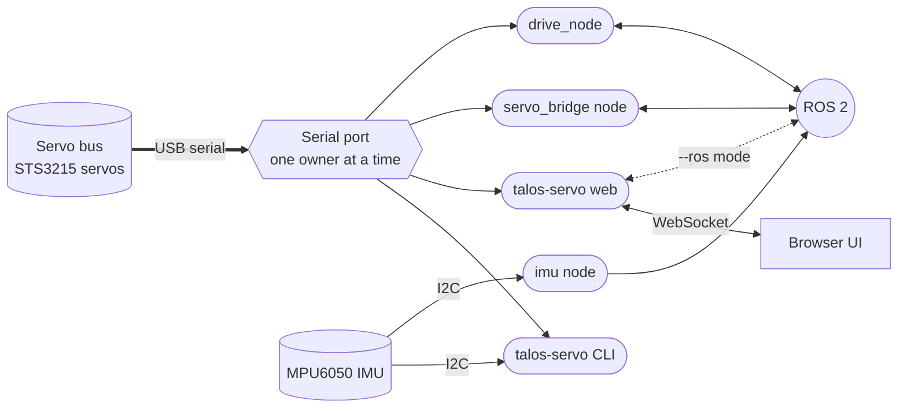
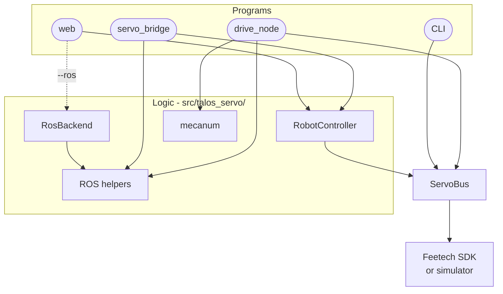
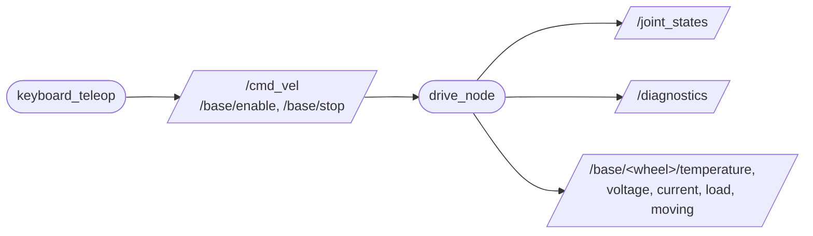
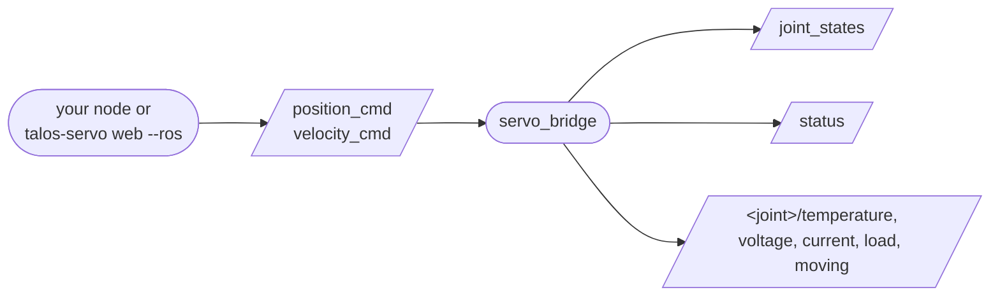
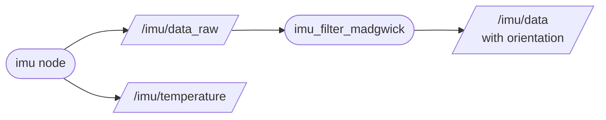

# talos_hack

Software and tests for the Talos robot from the physical AI hackathon. The robot uses Feetech
STS/SMS serial bus servos daisy-chained on one bus.

Contributing (humans and AI agents): read [AGENTS.md](AGENTS.md). Everything goes through PRs.

## Architecture

Three small diagrams, each answering one question. Shapes mean the same thing in all of them:
cylinder = hardware, rounded box = a program you start, rectangle = library code,
slanted box = ROS 2 topic.

### What runs where?



The four servo programs can open the servo port themselves, so run only one of them at a time.
The exception is `talos-servo web --ros`: it leaves the port to `servo_bridge` and sends its
commands over ROS 2, so the browser UI and your ROS nodes can drive the robot together (see
[Web UI over ROS 2](#web-ui-over-ros-2)). The imu node only uses I2C and can run alongside any of
them.

| Program | Start it with | Use it for | Details |
|---|---|---|---|
| `talos-servo` CLI | `uv run talos-servo ...` | ping, spin, set IDs, read the IMU | [Usage](#usage) |
| `talos-servo web` | `uv run talos-servo web`, or `pixi run -e ros web-ros` next to `servo_bridge` | control servos from a browser | [Web UI](#web-ui) |
| `servo_bridge` node | `pixi run -e ros servo-node` | any servo from ROS 2, one joint per servo | [ROS 2](#ros-2) |
| `drive_node` | `pixi run drive` | the four mecanum wheels from `/cmd_vel` | [Mecanum base](#ros-2-jazzy-mecanum-base) |
| `imu` node | `pixi run -e ros imu-node` | IMU accel and gyro on `/imu/data_raw` | [IMU on ROS 2](#imu-on-ros-2) |

### Which code does each program use?



| Box | File | Job |
|---|---|---|
| RobotController | `web/controller.py` | shared servo state, polling, command limits from `config/web.yaml` |
| RosBackend | `ros/web_backend.py`, `ros/web_client_node.py` | same commands as RobotController, sent to `servo_bridge` over topics and services (`web --ros`) |
| ROS helpers | `ros/convert.py`, `ros/readouts.py` | steps to radians, wheel odometry, per joint readout topics |
| mecanum | `mecanum.py` | body velocity to four wheel speeds |
| ServoBus | `bus.py` | every servo read and write; checks each SDK result and stops spinning servos on close |
| Feetech SDK or simulator | `scservo_sdk`, `web/sim.py` | the real serial protocol, or fake servos for `--mock` |

### How does data flow through ROS 2?

The mecanum base, driven from the keyboard:



Any servo, driven by your own node:



The IMU, with orientation from the Madgwick filter:



`servo_bridge` topics live under `/servo_bridge/`. Both nodes stop the wheels when commands stop
arriving. The full topic and service tables are in [ROS 2](#ros-2) and
[ROS 2 Jazzy mecanum base](#ros-2-jazzy-mecanum-base).

## Setup

Use either [uv](https://docs.astral.sh/uv/) or [pixi](https://pixi.sh). Both install the
official Feetech SDK (`ftservo-python-sdk`, imported as `scservo_sdk`) and the `talos-servo`
command from the same `pyproject.toml`.

```
uv sync          # pure Python, creates .venv
pixi install     # conda based, creates .pixi/
```

pixi also provides ROS 2 Jazzy (from the RoboStack `robostack-jazzy` channel, Python 3.12) in a
separate `ros` environment: `pixi install -e ros`. uv cannot install ROS, so ROS work needs pixi.
See [ROS 2](#ros-2).

The examples below use `uv run`. With pixi, use `pixi run` instead (or open `pixi shell`).

When you change dependencies in `pyproject.toml`, refresh both lockfiles: `uv lock` and
`pixi install`. Conda-only packages (ROS) go in `pixi.toml` with `pixi add`.

## Usage

Find your adapter's port:

```
uv run talos-servo ports
```

Pass it with `--port` or set it once per shell:

```
# PowerShell
$env:TALOS_SERVO_PORT = "COM5"
# bash
export TALOS_SERVO_PORT=/dev/serial/by-id/usb-1a86_USB_Single_Serial_5B7B014358-if00
```

| Command | What it does |
|---|---|
| `talos-servo ping --ids 1-3` | Check which servos answer and print their model number |
| `talos-servo spin --ids 1,2,3 --speed 100 --seconds 3` | Wheel mode + torque on, spin, then stop |
| `talos-servo monitor --ids 1` | Print position and speed every second until Ctrl+C |
| `talos-servo monitor --ids 1 --speed 500` | Same, while spinning (stops on exit) |
| `talos-servo set-id --id 1 --new-id 3` | Permanently change a servo's ID (refuses if 3 is taken) |

New servos ship with ID 1. To build a daisy chain, connect them one at a time and give each a
unique ID with `set-id` before chaining them.

Common options: `--baud` (default 1000000), `--acc` (acceleration, default 20), `-v` for debug logs.
Negative `--speed` spins the other way. Servos are always stopped on exit, including Ctrl+C and
errors.

The old scripts map to commands like this:

| Old script | Command |
|---|---|
| `tests/test_servo.py` | `talos-servo ping` |
| `tests/rotate_servo.py` | `talos-servo spin` |
| `tests/test_daisy_chain.py` | `talos-servo spin --ids 1-3 --speed 300 --seconds 60` |
| `tests/test_servo2.py` | `talos-servo monitor --ids 3 --speed 500 --acc 10` |
| `tests/change_ids.py` | `talos-servo set-id --id 1 --new-id 3` |

## IMU (MPU6050)

The MPU6050 accelerometer and gyro connects to the Raspberry Pi over I2C, separately from the
servo bus.

| MPU6050 | Pi header |
|---|---|
| VCC | pin 1 (3.3 V) |
| GND | pin 6 (GND) |
| SDA | pin 3 (GPIO2) |
| SCL | pin 5 (GPIO3) |
| AD0 | GND for address 0x68 (or 3.3 V for 0x69) |

Power it from 3.3 V: the Pi GPIO pins are not 5 V tolerant. Enable I2C with
`sudo raspi-config` (Interface Options, I2C), reboot, and check that `i2cdetect -y 1` shows `68`.

```
uv sync --extra imu                                # pixi install already includes it
uv run talos-servo imu --calibrate                 # zero the gyro, then stream until Ctrl+C
uv run talos-servo imu --seconds 5 --interval 0.05
```

Flat and still, it should read about `0 0 +1.00` g and near-zero gyro. Options: `--i2c-bus`
(default 1, or `$TALOS_IMU_BUS`), `--address` (default 0x68), `--accel-range` (2/4/8/16 g),
`--gyro-range` (250/500/1000/2000 deg/s).

```python
from talos_servo import Mpu6050

with Mpu6050() as imu:
    imu.calibrate_gyro()
    sample = imu.read()
    print(sample.accel, sample.gyro, sample.temperature)
```

### IMU on ROS 2

`talos-imu-ros` (`src/talos_servo/ros/imu_node.py`) publishes the sensor as standard ROS
messages, and the stock `imu_filter_madgwick` package turns that into an orientation. Run each in
its own terminal on the Pi:

```
pixi run -e ros imu-node      # zeroes the gyro first: keep the robot still for a second
pixi run -e ros imu-filter    # settings in config/imu_filter.yaml
```

| Topic | Type | What it carries |
|---|---|---|
| `/imu/data_raw` | `sensor_msgs/Imu` | accel in m/s^2 (gravity included, about +9.8 on z when flat), gyro in rad/s, no orientation, 100 Hz |
| `/imu/data` | `sensor_msgs/Imu` | the same plus an orientation quaternion, from the Madgwick filter |
| `/imu/temperature` | `sensor_msgs/Temperature` | die temperature in deg C, 1 Hz |

The node takes the same `--i2c-bus`, `--address`, `--accel-range` and `--gyro-range` options as
the CLI, plus `--dlpf`. ROS parameters (`--ros-args -p name:=value`): `rate_hz` (100),
`frame_id` (`imu_link`), `calibrate` (true), `temperature_hz` (1), `max_read_failures` (25, the
node exits after that many failed reads in a row), `angular_velocity_variance` and
`linear_acceleration_variance` (covariances for an EKF downstream).

No Kalman filter is needed for orientation. The MPU6050 has no magnetometer, so roll and pitch
are corrected by gravity and stay stable, but yaw comes from the gyro alone and drifts slowly. A
`robot_localization` EKF that fuses the IMU with wheel odometry is tracked in #36.

## Using the library

```python
from talos_servo import ServoBus

with ServoBus("COM5") as bus:
    bus.enable_wheel_mode([1, 2])
    bus.set_speed(1, 100)
    print(bus.read_position_speed(1))
# every servo started above is stopped here, even if the block raised
```

## Development

```
uv run pytest           # tests use a fake SDK, no hardware needed
uv run ruff check .
uv run ruff format .
```

The same checks as pixi tasks:

```
pixi run test
pixi run lint
pixi run fmt
pixi run check   # lint + format check + tests, like CI
```

## Web UI

Browser control for the robot's servos: each one switches between **Position** and **Speed**
(wheel) mode, with live position, speed, load, voltage and temperature.

```
 laptop browser(s) --http/ws-->  Pi :8000  --USB serial-->  servo bus
                                 talos-servo web
                                 serves web/out (Next.js UI)
```

- `src/talos_servo/web/` - the `talos-servo web` command: FastAPI server on top of `ServoBus`
  that streams servo state over a WebSocket and serves the UI
- `web/` - Next.js UI, built as static files into `web/out`
- `config/web.yaml` - servo IDs, names, joint limits and the UI speed cap

Install the web extra (`pixi install` already includes it):

```
uv sync --extra web
```

Build the UI once (Node 20+; can be built on a laptop and copied to the Pi):

```
cd web && npm install && npm run build
```

Run it:

```
uv run talos-servo web --port /dev/ttyACM0     # real servos (or set TALOS_SERVO_PORT)
uv run talos-servo web --mock                  # simulated servos, no hardware
```

Then from any laptop on the same network open `http://<pi-hostname>.local:8000` (or the Pi's IP).
Several laptops can connect at once and see the same live state.

- **Position mode**: drag the target slider (moves live) or type a value and press Go. 0-4095 is
  one full turn; the amber marker is the current position
- **Speed mode**: slider centre is stop, left is reverse, right is forward
- **STOP ALL** (or Space) stops every servo in speed mode
- **Torque** off lets you move a joint by hand

Safety: when every browser disconnects, the server stops all speed-mode servos, and it stops them
again on shutdown. Speeds are capped by `max_speed` and targets are clamped to each servo's
`min_pos`/`max_pos` in `config/web.yaml`, so set real joint limits there before running on the
robot.

To start on boot, edit the user, paths and port in `deploy/talos-web.service`, then follow the
steps at the top of that file.

UI development with hot reload: run `uv run talos-servo web --mock`, then `cd web && npm run dev`
and open `http://localhost:3000` with `NEXT_PUBLIC_BRIDGE_URL=ws://localhost:8000/ws` set (or a
Pi's address instead of localhost).

### Web UI over ROS 2

By default `talos-servo web` owns the serial port, so nothing else can drive the servos while it
runs. With `--ros` it opens no port and drives the robot through a running `servo_bridge` node
instead, so the browser UI and your own ROS nodes share the robot:

```
pixi run -e ros servo-node-mock     # or servo-node for real servos (it owns the port)
pixi run -e ros web-ros             # same UI on :8000, commands go over ROS 2
```

`--bridge /other_bridge` picks a bridge running under another name. The UI works the same, with
these differences:

- the server re-sends each wheel speed every telemetry tick to feed the bridge's
  `command_timeout` watchdog, so if the web server dies the bridge stops the wheels
- the acceleration setting is ignored (the bridge has no acceleration input)
- when a ROS node and the browser command the same joint, the last command wins
- servos show as offline if the bridge stops publishing `status`

`drive_node` opens the port itself, so it still cannot run next to `servo_bridge` or the web UI.

## ROS 2

`talos-servo-ros` is a ROS 2 node (`src/talos_servo/ros/servo_bridge_node.py`) on top of the same
controller, config (`config/web.yaml`) and simulator as the web UI. It only uses standard message
types, so there is no colcon build step.

```
pixi install -e ros
pixi run -e ros servo-node-mock                          # simulated servos
TALOS_SERVO_PORT=/dev/ttyACM0 pixi run -e ros servo-node # real servos
pixi run -e ros talos-servo-ros --help                   # all options
```

Use `pixi shell -e ros` for a shell where `ros2` works. Everything lives under `/servo_bridge/`.
Joint names come from the config names (`"Servo 1"` becomes `servo_1`). Angles are radians with
0 at half a turn (step 2048), so a joint covers about -pi..pi.

| Name | Type | What it does |
|---|---|---|
| `joint_states` (out) | `sensor_msgs/JointState` | position (rad), velocity (rad/s), effort (raw load) at `telemetry_hz` |
| `status` (out) | `diagnostic_msgs/DiagnosticArray` | online, mode, torque, voltage, temperature, current (A), moving, errors (2 Hz) |
| `<joint>/temperature` (out) | `sensor_msgs/Temperature` | deg C, at the status rate, online servos only |
| `<joint>/voltage`, `<joint>/current`, `<joint>/load` (out) | `std_msgs/Float32` | V, A, raw load (about -1000..1000) |
| `<joint>/moving` (out) | `std_msgs/Bool` | the servo's moving flag |
| `position_cmd` (in) | `sensor_msgs/JointState` | move joints by name; optional `velocity` (rad/s) sets the move speed |
| `velocity_cmd` (in) | `sensor_msgs/JointState` | spin wheel-mode joints by name (rad/s) |
| `stop_all` | `std_srvs/Trigger` | stop every wheel-mode servo |
| `<joint>/set_wheel_mode` | `std_srvs/SetBool` | true = speed (wheel) mode, false = position mode |
| `<joint>/set_torque` | `std_srvs/SetBool` | torque on or off |

```
ros2 topic pub --once /servo_bridge/position_cmd sensor_msgs/msg/JointState   "{name: [servo_1], position: [0.5]}"
ros2 service call /servo_bridge/servo_2/set_wheel_mode std_srvs/srv/SetBool "{data: true}"
ros2 topic pub -r 10 /servo_bridge/velocity_cmd sensor_msgs/msg/JointState   "{name: [servo_2], velocity: [1.0]}"
```

Safety: velocity commands are a deadman signal. A wheel servo stops when it gets no new
`velocity_cmd` within `command_timeout` seconds (default 0.5, set with
`--ros-args -p command_timeout:=1.0`), so publish at 10 Hz or more. All wheel servos are stopped
at startup and on shutdown (including Ctrl+C), and the same `min_pos`/`max_pos` and `max_speed`
limits as the web UI apply. The node and the web UI in its default mode both open the serial
port, so run one at a time, or run the web UI with `--ros` (see
[Web UI over ROS 2](#web-ui-over-ros-2)).

The `ros` environment is tested on the Raspberry Pi 5 (linux-aarch64). On Windows it currently
hangs while activating, so run ROS on Linux (or WSL) for now.

## ROS 2 Jazzy mecanum base

The `ros2_ws/src/talos_mecanum` package provides a four-wheel base driver and a terminal
keyboard interface. Pixi installs ROS 2 Jazzy and colcon for Linux ARM64, including Raspberry Pi
OS 64-bit. Build once with `pixi run ros-build`, then start the driver with `pixi run drive` and
the keyboard interface in another terminal with `pixi run teleop`. Set the servo port before
starting the driver, for example:

```
export TALOS_SERVO_PORT=/dev/serial/by-id/your-servo-adapter
```

The driver accepts `geometry_msgs/msg/Twist` on `/cmd_vel`. It provides `/base/enable`
(`std_srvs/srv/SetBool`) to ping IDs 1-4, select wheel mode, and enable torque, and `/base/stop`
(`std_srvs/srv/Trigger`) to stop all four wheels. Drive starts disabled; press `m` in the keyboard
interface to enable or disable. Use `w`/`s` to move forward/back, `a`/`d` to strafe, `q`/`e` to
turn, space to stop, and `x` to exit. Direction keys send short pulses; press repeatedly for
continuous movement. Commands stop automatically if `/cmd_vel` is not updated for 0.5 seconds.

While the drive is enabled, the driver also publishes the wheel servo readouts. Nothing is read
while it is disabled, because the serial port is closed then.

| Topic | Type | Rate param (default) | Content |
| --- | --- | --- | --- |
| `/joint_states` | `sensor_msgs/msg/JointState` | `joint_state_rate_hz` (10) | `front_left_wheel`, `front_right_wheel`, `rear_left_wheel`, `rear_right_wheel`: position in rad (unwrapped, 0 at enable), velocity in rad/s, effort = raw servo load (about -1000..1000, refreshed at the diagnostics rate) |
| `/diagnostics` | `diagnostic_msgs/msg/DiagnosticArray` | `diagnostics_rate_hz` (1) | One status per servo with voltage, temperature, load, current (A), moving flag, raw position and speed. Level ERROR with the error text if a read fails |
| `/base/<wheel>/temperature` | `sensor_msgs/msg/Temperature` | `diagnostics_rate_hz` (1) | deg C, `header.frame_id` is the wheel joint name |
| `/base/<wheel>/voltage`, `current`, `load` | `std_msgs/msg/Float32` | `diagnostics_rate_hz` (1) | V, A, raw load. Not published for a wheel whose read failed |
| `/base/<wheel>/moving` | `std_msgs/msg/Bool` | `diagnostics_rate_hz` (1) | the servo's moving flag |

Signs follow `wheel_directions`, so positive means forward for every wheel. A failed read is logged
and reported on `/diagnostics` but does not disable the drive. Check them with:

```
ros2 topic echo /joint_states
ros2 topic echo /base/front_left_wheel/temperature
ros2 topic echo /diagnostics
```

Before enabling on the floor, edit `ros2_ws/src/talos_mecanum/config/robot.yaml` to match the
physical wheel-to-servo mapping and each wheel's direction. The defaults assume IDs 1-4 are ordered
front-left, front-right, rear-left, rear-right and use positive direction signs. Set
`wheel_ids`, `wheel_directions`, measured `wheelbase_m` and `track_width_m`, and calibrated
`steps_per_meter` for the actual robot. The geometry and scale defaults are placeholders; the
driver caps commands to 100 servo steps/s and 0.1 m/s linear speed until configured. Start with the
wheels lifted and a clear area.

On Raspberry Pi OS 64-bit, install Pixi, then run these commands from the repository:

```
pixi install
pixi run ros-build
export TALOS_SERVO_PORT=/dev/serial/by-id/usb-1a86_USB_Single_Serial_5B7B014358-if00
pixi run drive
```

In a second terminal, from the repository, run `pixi run teleop`. If the adapter uses another
device, set `TALOS_SERVO_PORT` to its `/dev/serial/by-id/...` path instead. Keep the wheels lifted
until wheel order, direction, and calibration are verified.
