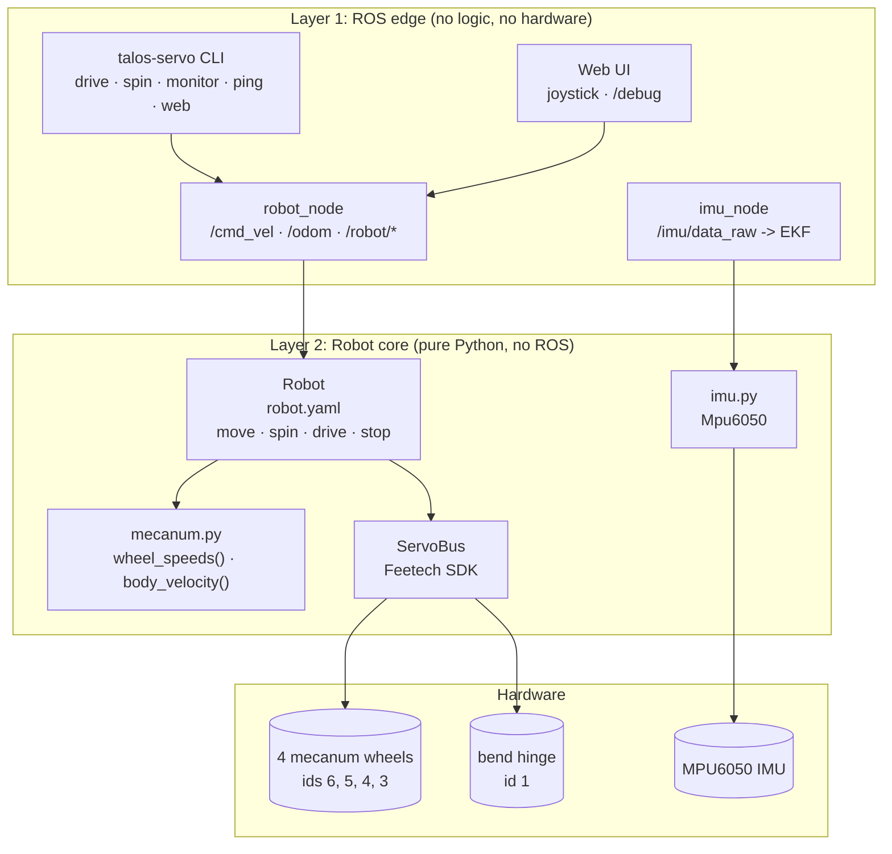
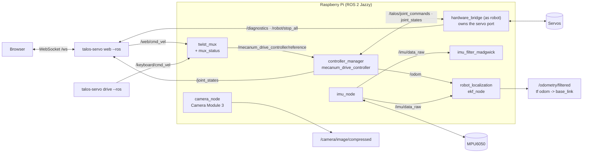
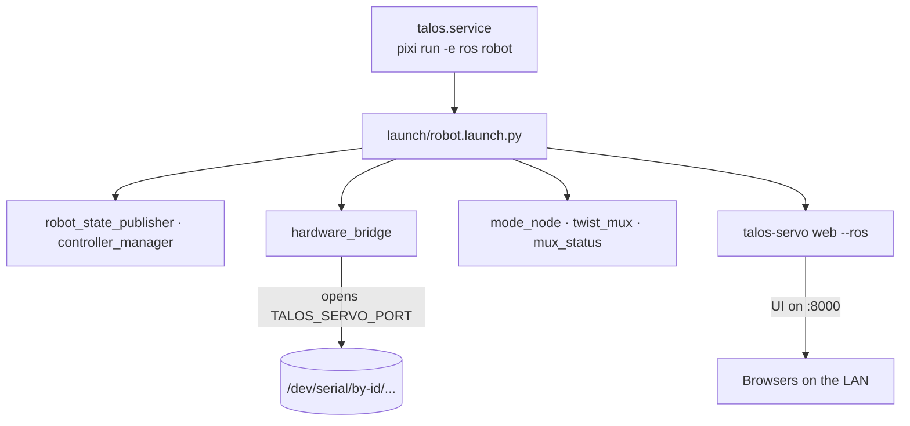
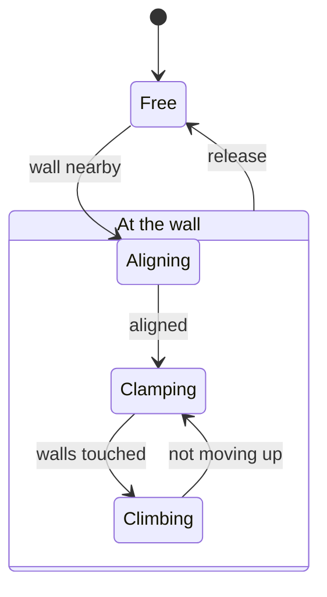

# talos_hack

Software for the Talos robot from the physical AI hackathon: a mecanum base
driven by Feetech STS/SMS serial bus servos on one bus, plus an MPU6050 IMU.

Contributing (humans and AI agents): read [AGENTS.md](AGENTS.md). Everything
goes through PRs.

## Start the robot

On the Pi, from the repo folder (no arguments: the servo port is found by
itself, the IMU chain starts too):

```
pixi run -e ros robot
```

Then open `http://<pi>:8000`, press **Release STOP** and drive. Details
and options are under "Run the robot" below.

## Architecture

**One rule: one `Robot` owns the servo bus, one node owns the `Robot`.**



| Layer | Job | Rule |
| --- | --- | --- |
| 1. ROS edge | Messages and keys to method calls | No logic, no hardware |
| 2. Robot core | All logic and hardware access | No ROS, tested with fakes |

Without ROS, the CLI and the web server build the `Robot` themselves on the
serial port. Then nothing else can use the servos.

| Path | What it is |
| --- | --- |
| `src/talos_servo/robot.py` | `Robot`: limits, direction, watchdog, stop |
| `src/talos_servo/config.py` | Reads `config/robot.yaml` |
| `src/talos_servo/mecanum.py` | Mecanum kinematics, pure functions |
| `src/talos_servo/bus.py` | `ServoBus`: safe wrapper around the SDK |
| `src/talos_servo/cli.py` | The `talos-servo` command |
| `src/talos_servo/teleop.py` | Keyboard driving for `talos-servo drive` |
| `src/talos_servo/ros/` | `robot_node`, `imu_node`, the ROS client |
| `src/talos_servo/ros/camera_node.py` | Raspberry Pi CSI camera node |
| `src/talos_servo/web/` | FastAPI server for the web UI |
| `web/` | Next.js UI, built into `web/out` |
| `deploy/` | systemd units for the Pi |

### ROS graph



With `ros2_control:=false` the old `robot_node` owns the port instead: twist_mux
feeds it on `/cmd_vel`, it publishes `/odom`, and the web server's `/debug`
page commands single joints through it.

### On the Pi



### Robot modes

The mode node (`src/talos_servo/modes.py`) walks the robot through a climb.
Release (L) goes back to Free from any of the wall modes.



### ros2_control (#62)

The base drives through ros2_control: `mecanum_drive_controller` (#65) on
the topic based hardware plugin plus `hardware_bridge_node`, see
[docs/ros2_control.md](docs/ros2_control.md). `pixi run -e ros robot` starts
it with the teleop nodes. Without them, on the bench (stop the robot node
first):

```
pixi run -e ros ros2-control port:=/dev/ttyACM0
ros2 topic pub -r 10 /mecanum_drive_controller/reference \
  geometry_msgs/msg/TwistStamped "{twist: {linear: {x: 0.05}}}"
ros2 topic pub --once /bend_position_controller/commands \
  std_msgs/msg/Float64MultiArray "{data: [2.8]}"      # alpha in rad
ros2 topic echo /dynamic_joint_states                 # effort = current
```

The hinge does not move at startup: send a new goal to move it.

To open or close the hinge with the wheels rolling along, publish a rate in
rad/s (positive opens) to the expansion node (#76), started by
`pixi run -e ros robot`. Release STOP first. Details are in
[docs/ros2_control.md](docs/ros2_control.md#opening-and-closing-the-hinge-76).

```
ros2 topic pub -r 10 /expansion/rate std_msgs/msg/Float64 "{data: 0.1}"
```

### Robot model (#64)

`description/talos.urdf.xacro` is the robot for ROS: the `bend` hinge, the
two legs and the four mecanum wheels, plus `imu_link`, `camera_link` and
`camera_optical_frame`. It
reads its sizes, limits and joint names from the `model` and `base` sections
of `config/robot.yaml`, so change them there.

The robot is an inverted V: the hinge on top with the platform, a leg down
to each wheel pair. Each leg is half of `base.wheelbase_m` (the flat
wheelbase) long. The hinge joint (`model.hinge_joint`, `bend`) is the
opening angle between the legs in radians: pi (180 deg) flat,
`bend_min_deg` at max fold.
The legs follow it through mimic joints, each tilting by half the fold, so
the platform stays level. The wheelbase is `2 * l * sin(bend / 2)`
(`talos_servo.model.wheelbase_m`).

The `<ros2_control>` block drives the four wheels and the hinge. The
hardware bridge turns the opening angle into servo steps
(`talos_servo.hinge`) from the fixed flat servo position
`model.bend_flat_steps` (the horn is aligned to the leg).

How fast the wheels must turn while the hinge opens or closes, with test
vectors for the expansion controller (#76), is in
[docs/hinge_kinematics.md](docs/hinge_kinematics.md).

View it in RViz2 (needs a display; installs RViz only in the `viz`
environment, not on the Pi; works on Linux and Windows):

```
pixi install -e viz
pixi run -e viz view-model    # RViz2 plus a slider per joint
```

Drag the `bend` slider from 3.14 (flat) down to 1.57 (max fold): the legs
fold symmetrically and the platform stays level. Check the model with
`pixi run -e ros check-model` (`check_urdf`) or print it with
`pixi run -e ros model-urdf`.

To watch the live robot instead (#127), start it with `viz:=true` on the Pi
and open RViz on a laptop on the same network and `ROS_DOMAIN_ID`:

```
pixi run -e ros robot viz:=true    # on the Pi
pixi run -e viz view-live          # on the laptop
```

The hinge and wheels follow the servos through ros2_control's
`/joint_states`, and the model moves in the `odom` frame. Without the IMU the
EKF runs on wheel odometry alone, so the pose drifts; it does not follow the
robot up a chimney. `viz:=true` needs ros2_control (the default). Do not run
`view-model` at the same time: its sliders publish `/joint_states` too. If
the laptop sees no topics over Wi-Fi, multicast discovery is blocked: set up
a Fast DDS discovery server or a CycloneDDS peer list.

## Quick start

Use [uv](https://docs.astral.sh/uv/) or [pixi](https://pixi.sh); both read
`pyproject.toml`. ROS 2 Jazzy comes only through pixi (`ros` environment).

```
uv sync                  # or: pixi install
pixi install -e ros      # ROS 2, for the robot node, IMU node and EKF
```

Find the servo adapter and set it once per shell (or pass `--port`):

```
uv run talos-servo ports
export TALOS_SERVO_PORT=/dev/serial/by-id/usb-1a86_USB_Single_Serial_5B7B014358-if00  # bash
$env:TALOS_SERVO_PORT = "COM5"                                     # PowerShell
```

## Run the robot

One command starts everything driving needs: ros2_control with the
mecanum controller and the hardware bridge, the mode node, twist_mux,
mux_status and the web UI.

```
cd web && npm install && npm run build      # once, Node 20+
pixi run -e ros robot                       # finds the servo port itself
pixi run -e ros robot camera:=true          # plus the camera
```

Open `http://<pi>.local:8000` and press **Release STOP**: STOP is on at
start. Drive from a laptop keyboard too with `pixi run -e ros drive`.
Ctrl+C stops everything, and the wheels with it.

| Option | Default | Adds |
| --- | --- | --- |
| `port:=` | found | servo port: `$TALOS_SERVO_PORT`, else the one adapter under `/dev/serial/by-id`, else `/dev/ttyACM0` |
| `web:=` | `true` | web UI on :8000 |
| `camera:=` | `false` | camera node |
| `imu:=` | `true` | IMU node, Madgwick filter, EKF (`false` on a bench without the IMU) |
| `ros2_control:=` | `true` | `false`: the old robot node drives instead |
| `viz:=` | `false` | EKF for the live robot in RViz (see below) |

The per-motor `/debug` page needs `ros2_control:=false`: under ros2_control
the controllers own the joints, so single-joint commands are not served.

Drive commands are `TwistStamped` and the controller drops ones older than
0.5 s. Keyboard driving from a laptop therefore needs the laptop clock in step
with the Pi (NTP, as both get by default when online).

The single pixi tasks below still start one piece each, for debugging.

## Commands

| Command | What it does |
| --- | --- |
| `talos-servo ping --ids 1-6` | Which servos answer, with their model number |
| `talos-servo spin --ids 1 --speed 100` | Spin for 1 s, then stop |
| `talos-servo monitor --ids 1` | Print position and speed until Ctrl+C |
| `talos-servo set-id --id 1 --new-id 3` | Change a servo id (EEPROM) |
| `talos-servo drive` | Drive with the keyboard: W/S, A/D, Q/E, Space stop, X quit |
| `talos-servo web` | Browser UI on port 8000: joystick at `/`, per-motor page at `/debug` |
| `talos-servo imu --calibrate` | Stream the MPU6050 until Ctrl+C |
| `talos-servo calibrate-bend` | Measure hinge flat and max fold through the running robot: O/F jog, Enter records, X cancels. Saves `config/bend_calibration.yaml` |
| `pixi run -e ros robot` | The whole robot, see "Run the robot" |
| `pixi run -e ros robot-node` | The robot node, the only program on the port |
| `pixi run -e ros drive` | `talos-servo drive --ros`, plus N wall nearby, L release, Enter release STOP, R/F open/close the hinge |
| `pixi run -e ros web-ros` | `talos-servo web --ros`, needed to drive from the joystick |
| `pixi run -e ros imu-node` | IMU as ROS topics |
| `pixi run -e ros mode-node` | Robot mode, switches controllers per mode |
| `pixi run -e ros ekf` | Pose estimate from wheels and gyro |
| `pixi run -e ros twist-mux` | Web and keyboard share `/cmd_vel` |
| `pixi run -e ros mux-status` | Who drives, on `/robot/active_input` |

- `--ros` (on `spin`, `monitor`, `drive`, `web`) goes through the running robot
  node instead of the port, so these can run next to each other.
- `ping`, `spin`, `monitor` and `set-id` without `--ros` are bench tools: they
  take servo ids and work without a config.
- `drive --ros` publishes on `/keyboard/cmd_vel`, so it needs `twist-mux`.
  Space also turns STOP on for every input (`/robot/set_stop`) and Enter
  releases it. N calls `/robot/wall_nearby` and L `/robot/release` on the
  mode node, without freezing the keys during a slow switch. It
  prints the mode, why it changed and which input drives, also when the web
  changes them. Q/E do nothing while climbing, and the drive keys do nothing
  while aligning or clamping. Holding R or F opens or closes the hinge
  through the expansion node (`/expansion/rate`, #76) in free and clamping;
  letting go stops it. Quitting stops only the keyboard input.
- Every command stops what it started on exit, including Ctrl+C.
- New servos ship with id 1. Connect them one at a time and give each its own
  id with `set-id` before chaining them.

## Config: `config/robot.yaml`

Every joint is set here and nowhere else. Changes take effect on restart.

```yaml
max_speed: 1000          # steps/s cap for every joint, low on purpose
command_timeout_s: 0.5   # ROS speed commands stop if not repeated
joints:
  front_left_wheel:  { id: 6, control: speed,    inverted: true }
  front_right_wheel: { id: 5, control: speed,    inverted: false }
  rear_left_wheel:   { id: 4, control: speed,    inverted: true }
  rear_right_wheel:  { id: 3, control: speed,    inverted: false }
  bend:              { id: 1, control: position, inverted: false,
                       min_pos: 0, max_pos: 4095 }
base:
  wheels: [front_left_wheel, front_right_wheel, rear_left_wheel,
           rear_right_wheel]
  wheelbase_m: 0.31
  track_width_m: 0.128
  wheel_radius_m: 0.03     # steps per metre = 4096 / (2 * pi * r)
  max_linear_speed: 0.1    # m/s
  max_angular_speed: 0.5   # rad/s
```

| Key | Values | What it does |
| --- | --- | --- |
| `control` | `speed` / `position` | Fixed at startup; spin needs speed |
| `inverted` | `false` / `true` | Flips direction, so positive is forward |
| `enabled` | `true` / `false` | `false`: never touched, hidden everywhere |

- **Find the `inverted` values:** lift the wheels, run `talos-servo drive`,
  press W, and set `inverted: true` on any wheel that turns backwards.
- **bend:** folding must lower its position; set `inverted: true` if it
  folds the other way. Its topics appear under `/robot/bend/`. Its
  `min_pos`/`max_pos` are narrowed on load to the `model` bend range from
  `model.bend_flat_steps`, which is required while it is enabled.
- **Calibrate the hinge:** with the robot running, `pixi run -e ros
  calibrate-bend` records flat and max fold into
  `config/bend_calibration.yaml` (gitignored, so `git clean -fdx` deletes
  it). It overrides `bend_flat_steps` and `bend_min_deg`. See "Calibration"
  in `docs/ros2_control.md`.

## ROS topics

| Topic or service | Type | Direction |
| --- | --- | --- |
| `/mecanum_drive_controller/reference` | `geometry_msgs/TwistStamped` | in: drive the base (twist_mux output) |
| `/cmd_vel` | `geometry_msgs/TwistStamped` | in: drive the base, robot node only |
| `/odom` | `nav_msgs/Odometry` | out: wheel odometry, no TF |
| `/joint_states` | `sensor_msgs/JointState` | out: rad, rad/s, load |
| `/diagnostics` | `DiagnosticArray` | out: one entry per joint |
| `/robot/position_cmd` | `sensor_msgs/JointState` | in: goal angles |
| `/robot/velocity_cmd` | `sensor_msgs/JointState` | in: speeds, expire |
| `/robot/<joint>/temperature` ... | `Temperature`, `Float32`, `Bool` | out |
| `/robot/stop_all` | `std_srvs/Trigger` | stop every speed joint |
| `/robot/<joint>/set_torque` | `std_srvs/SetBool` | torque on/off |
| `/robot/mode`, `/robot/mode_reason` | `std_msgs/String` | out: latched |
| `/robot/wall_nearby` | `std_srvs/Trigger` | free -> aligning |
| `/robot/release` | `std_srvs/Trigger` | any mode -> free |
| `/robot/hinge_motion` | `std_srvs/SetBool` | free: wheels to the expansion node |
| `/robot/wall_contact` | `std_srvs/Trigger` | clamping -> climbing (expansion node) |
| `/robot/no_wall` | `std_srvs/Trigger` | clamping: no wall found, mode kept |
| `/robot/bend/calibrate/<step>` | `std_srvs/Trigger` | hinge calibration, used by `talos-servo calibrate-bend` |
| `/expansion/rate` | `std_msgs/Float64` | in: open (+) or close (-) the hinge, rad/s |
| `/imu/data_raw`, `/imu/data` | `sensor_msgs/Imu` | out: IMU, filtered (the web page reads the tilt from `/imu/data`) |
| `/camera/image/compressed` | `sensor_msgs/CompressedImage` | out: low-resolution JPEG stream |
| `/camera/snapshot/compressed` | `sensor_msgs/CompressedImage` | out: one full-resolution JPEG per request |
| `/camera/take_snapshot` | `std_srvs/Trigger` | capture and publish one snapshot |
| `/camera/stream` | `std_srvs/SetBool` | enable/disable camera stream |
| `/odometry/filtered` | `nav_msgs/Odometry` | out: EKF pose |
| `/web/cmd_vel` | `geometry_msgs/TwistStamped` | in: twist_mux, web |
| `/keyboard/cmd_vel` | `geometry_msgs/TwistStamped` | in: twist_mux, keyboard |
| `/robot/set_stop` | `std_srvs/SetBool` | true: STOP, false: release |
| `/robot/stop_lock` | `std_msgs/Bool` | out: STOP state, 10 Hz |
| `/robot/active_input` | `std_msgs/String` | out: who drives |

`/cmd_vel` and `velocity_cmd` stop the wheels unless repeated within
`command_timeout_s`. Every client on the robot must use the same
`ROS_DOMAIN_ID`.

### Web and keyboard through twist_mux

`twist_mux` merges `/web/cmd_vel` and `/keyboard/cmd_vel` into
`/mecanum_drive_controller/reference` (`/cmd_vel` with
`ros2_control:=false`), see `config/twist_mux.yaml`. The keyboard has the
higher priority, so it wins while a key is held; an input that is quiet for
0.5 s stops counting and the other one takes over. STOP blocks both: the mode node owns it, starts with
STOP on and repeats it on `/robot/stop_lock` every 0.1 s. Release it with
`/robot/set_stop` `false`. The lock times out after 0.5 s, so the mux stays
locked while the mode node is not running, and a restarted twist_mux is
locked again by the next beat. `mux-status` publishes `keyboard`, `web`,
`none` or `locked` on `/robot/active_input` for the UIs.

The web server (`web-ros`) sends the browser's `drive` messages on
`/web/cmd_vel`. The browser re-sends them every 100 ms while a button is held
and sends one stop on release, so a closed tab drops out of the mux within
0.5 s.

`drive --ros` sends the keys on `/keyboard/cmd_vel`. STOP from anywhere wins
over every input: the web **STOP** button (**STOP ALL** on `/debug`, Space
on both pages) and Space in `drive --ros` turn it on through
`/robot/set_stop`, so an input that is still sending cannot drive again.
Release it with **Release STOP** on the web pages (shown while STOP is on),
Enter on either, or `/robot/set_stop` `false`.

```
pixi run -e ros mode-node
pixi run -e ros twist-mux
pixi run -e ros mux-status
ros2 topic pub -r 10 /web/cmd_vel geometry_msgs/msg/TwistStamped \
  "{twist: {linear: {x: 0.05}}}"
ros2 service call /robot/set_stop std_srvs/srv/SetBool "{data: false}"
ros2 service call /robot/set_stop std_srvs/srv/SetBool "{data: true}"
ros2 topic echo /robot/active_input
```

### ROS commands

Run these in `pixi shell -e ros` (or prefix them with `pixi run -e ros`). Keep
the wheels lifted the first time.

Drive the base. `/cmd_vel` stops unless repeated, so publish at a rate; Ctrl+C
stops the wheels within `command_timeout_s`:

```
ros2 topic pub -r 10 /cmd_vel geometry_msgs/msg/TwistStamped \
  "{twist: {linear: {x: 0.05}}}"         # forward
ros2 topic pub -r 10 /cmd_vel geometry_msgs/msg/TwistStamped \
  "{twist: {linear: {y: 0.05}}}"         # strafe left
ros2 topic pub -r 10 /cmd_vel geometry_msgs/msg/TwistStamped \
  "{twist: {angular: {z: 0.3}}}"         # turn left
```

One joint. Velocities are rad/s (1 rad/s is about 650 steps/s), positions are
rad with 0 at mid travel:

```
ros2 topic pub -r 10 /robot/velocity_cmd sensor_msgs/msg/JointState \
  "{name: [front_left_wheel], velocity: [1.0]}"
ros2 topic pub --once /robot/position_cmd sensor_msgs/msg/JointState \
  "{name: [bend], position: [0.5], velocity: [1.0]}"
```

Services and state:

```
ros2 service call /robot/stop_all std_srvs/srv/Trigger
ros2 service call /robot/front_left_wheel/set_torque std_srvs/srv/SetBool \
  "{data: false}"
ros2 topic echo /joint_states
ros2 topic echo /odom
ros2 topic echo /diagnostics             # one entry per joint
ros2 topic echo /robot/front_left_wheel/temperature
ros2 topic hz /odom
```

Robot node parameters go after `--ros-args`, e.g.
`pixi run -e ros talos-robot-ros --ros-args -p status_hz:=5.0`.

### Robot modes

The mode node (`pixi run -e ros mode-node`) owns the robot mode and switches
ros2_control controllers when it changes. The state machine itself is plain
Python in `talos_servo.modes`.

| From | Event | To |
| --- | --- | --- |
| `free` | wall nearby (`/robot/wall_nearby`) | `aligning` |
| `aligning` | aligned with the walls | `clamping` |
| `clamping` | wheels press on both walls (`/robot/wall_contact`) | `climbing` |
| `climbing` | not moving up | `clamping` |
| any | release (`/robot/release`) | `free` |

- Controllers per mode come from `modes.controllers` in `config/robot.yaml`:
  `mecanum_drive_controller` in `free` and `aligning`,
  `wheel_velocity_controller` for the expansion node in `clamping` and none
  yet in `climbing` (#92), so the base stops there.
  The node diffs the new mode's set against the controllers
  controller_manager reports as active, and a switch that controller_manager
  rejects keeps the old mode. Every second it also puts the active
  controllers back to the current mode's set (late start, restart, a switch
  applied after a timeout).
- While controller_manager is not running the switch is skipped with a
  warning, so the mode node works before the controllers exist. Set
  `-p require_controller_manager:=true` to make the mode change fail
  instead.
- In `clamping` and `climbing` STOP stops the wheels but the hinge keeps
  holding the walls.
- Entering `clamping` makes the expansion node open the hinge by itself
  until the hinge or a wheel current shows wall contact (#78), then it
  calls `/robot/wall_contact`. If the hinge opens fully first it calls
  `/robot/no_wall`: the mode stays `clamping` and the reason says no wall
  was found. Holding R or F while clamping takes over from it.
- `/robot/hinge_motion` (`std_srvs/SetBool`) is for the expansion node: in
  `free` it swaps `mecanum_drive_controller` for `wheel_velocity_controller`
  while the hinge moves. Refused outside `free` and `clamping` and while
  STOP is on.

```
ros2 topic echo /robot/mode
ros2 service call /robot/wall_nearby std_srvs/srv/Trigger
ros2 service call /robot/release std_srvs/srv/Trigger
```

## Web UI

Two pages: the joystick at `/` to drive the robot, on a phone or a laptop,
and the per-motor page at `/debug` for bench tests. Each links to the other.
Several browsers can connect at once.

```
cd web && npm install && npm run build    # once, Node 20+
pixi run -e ros robot                     # or: pixi run -e ros web-ros
uv run talos-servo web                    # without ROS: /debug only
```

### Joystick (`/`)

Open `http://<pi>.local:8000` on a phone or laptop on the same network.

```text
   [ CCW Q ]           [ CW E ]
             [ UP W ]
   [ LEFT A ] [ STOP ] [ RIGHT D ]
            [ DOWN S ]

   [ Wall nearby N ]   [ Release L ]
```

- **Hold to move:** a held button (or key) is re-sent every 100 ms and one
  stop is sent on release. Sliding the finger off, hiding the tab or the
  window losing focus also stops. One direction at a time.
- **STOP** (Space) turns STOP on for every input; **Release STOP** (Enter)
  shows in the header while STOP is on. STOP is on when the robot starts.
- **Wall nearby** (N) starts the climb (`free` to `aligning`); **Release**
  (L) goes back to `free` from any other mode (see Robot modes).
- **Level with the IMU** (in the "On the wall" panel after Wall nearby):
  the platform roll and pitch from the IMU trim the wheel pairs so the
  platform stays horizontal, also at rest (#82). It stops with STOP,
  Release, or a tilt past `level.tilt_fault_rad`, and shows the tilt and
  the trims. Gains and signs are `level` in `config/robot.yaml`.
- **Per mode:** the buttons the mode does not allow are greyed out.

  | Mode | Drive | Rotate | Wall nearby | Release |
  | --- | --- | --- | --- | --- |
  | `free` (XY) | yes | yes | yes | no |
  | `aligning`, `clamping` | no | no | no | yes |
  | `climbing` (Z) | yes | no | no | yes |

- The header shows the connection, the mode and why it changed, and which
  input is driving (web, keyboard or nobody), also when `drive --ros`
  changes them.
- On a desktop the keys are the same as in `drive --ros`: W/S, A/D, Q/E,
  Space, Enter, N and L.
- Driving and the mode buttons need the ROS web server (`web --ros`) with the
  mode node and twist_mux, which `pixi run -e ros robot` starts. With plain
  `talos-servo web` only STOP works.

### Per-motor page (`/debug`)

Each joint gets a card: a position slider for position joints, a speed
slider for speed joints, plus torque, live state and who sent the last
command. **STOP ALL** (or Space) stops every speed joint, including wheels
the CLI or a ROS node is driving, and over ROS turns STOP on (see twist_mux
above); **Release STOP** (or Enter) lets the base drive again.

When the last browser disconnects, the server stops only what the web
commanded: the joints it spins and its twist_mux input. Over ROS, keyboard
driving carries on. For UI work with hot reload, run `npm run dev` in `web/`
with `NEXT_PUBLIC_BRIDGE_URL=ws://<pi>:8000/ws`.

## IMU and pose estimate

Wire the MPU6050 to the Pi 5's I2C pins:

| MPU6050 | Pi header |
|---|---|
| VCC | pin 1 (3.3 V) |
| GND | pin 6 (GND) |
| SDA | pin 3 (GPIO2) |
| SCL | pin 5 (GPIO3) |
| AD0 | GND for address 0x68 (or 3.3 V for 0x69) |

Power it from 3.3 V: the Pi GPIO pins are not 5 V tolerant. Enable I2C with
`sudo raspi-config` (Interface Options, I2C), reboot, and check that
`i2cdetect -y 1` shows `68`.

`pixi run -e ros robot` starts the whole chain. One piece at a time:

```
pixi run -e ros imu-node     # keep the robot still while the gyro zeroes
pixi run -e ros imu-filter   # orientation, config/imu_filter.yaml
pixi run -e ros imu-tf       # base_link -> imu_link without ros2_control
pixi run -e ros ekf          # fuses /odom and gyro, config/ekf.yaml
```

The EKF uses wheel velocities and the gyro yaw rate only: mecanum wheels slip,
and the IMU has no magnetometer.

### Where the IMU sits (#91)

The board is screwed chip-down on the central platform, x axis forward, so
`imu` in `config/robot.yaml` has a roll of pi (its raw z acceleration reads
-g on a level floor). The URDF `imu_joint` reads it, so under
ros2_control robot_state_publisher publishes `base_link -> imu_link`; the
old robot node path runs `static_transform_publisher` with the same values.
If the board is ever moved, measure `xyz` (m, from the hinge axis centre)
and `rpy` (rad, the chip's axes against x forward, y left, z up) and put
them there.

The joystick page shows the platform roll and pitch from `/imu/data` with
the mount taken off ("Platform: pitch, roll"). Check it with the robot flat
on a level floor: both within 1 deg of zero (measured 0.1 and 0.8 deg).
Lifting the front must raise the pitch reading; if it drops, the board is
mounted backwards, so set `rpy: [0, 0, 3.1416]`.

### Keeping the platform level (#82)

On the wall the expansion node can trim the wheel pairs from the IMU
(`talos_servo.level`, "Level with the IMU" on the joystick page or
`/level/enable`): pitch (nose down) speeds the front pair up and the rear
pair down, roll (right side low) speeds the right pair up and the left pair
down, each a P loop with a deadband and a cap (`level` in
`config/robot.yaml`). It runs at rest too, so a clamped robot levels
itself, and on top of Up/Down/Left/Right. If a loop pushes the wrong way on
the bench, flip `level.pitch_sign` or `level.roll_sign`. Past
`level.tilt_fault_rad` the wheels stop and the loop turns off.
`/level/state` reports the tilt, the trims and the fault as JSON.

## Camera

The camera node uses Raspberry Pi OS's `rpicam-still` and `rpicam-vid` tools,
so it does not add Python camera libraries or a custom service package. Install
`rpicam-apps` on the Pi, then run the node:

```
pixi run -e ros camera-node
```

Camera index 0 is the default for the Camera Module 3 connected to CSI 0.
`/camera/take_snapshot` (`std_srvs/Trigger`) captures a full-resolution JPEG
and publishes it once on `/camera/snapshot/compressed`. `/camera/stream`
(`std_srvs/SetBool`) toggles 15 FPS 640x360 JPEG frames on
`/camera/image/compressed`. The stream starts on launch because
`stream_on_start` is true in `config/camera.yaml`. Taking a snapshot
temporarily pauses an active stream and resumes it after capture. Resolution,
frame rate, and camera index are in `config/camera.yaml`. Images use the
`camera_optical_frame` from the robot model.

Run `pixi run -e viz view-model` on a computer with a graphical display to see
the robot model plus live and snapshot image displays. The `viz` environment
installs the compressed image transport that RViz needs to decode the JPEG
frames, and the snapshot display also gets the last snapshot taken before RViz
opened. Call these services to
control the camera from a second terminal after `pixi shell -e viz`:

```
ros2 service call /camera/take_snapshot std_srvs/srv/Trigger "{}"
ros2 service call /camera/stream std_srvs/srv/SetBool "{data: true}"
ros2 service call /camera/stream std_srvs/srv/SetBool "{data: false}"
```

Do not launch RViz from a headless SSH session on the Pi. The camera node must
be running, and the Pi and viewer must use the same ROS domain.

## Deploy on the Pi

`deploy/talos.service` runs `pixi run -e ros robot` on boot. Build the web
UI once, edit the user, paths and serial port in the unit, then:

```
sudo cp deploy/talos.service /etc/systemd/system/
sudo systemctl daemon-reload
sudo systemctl enable --now talos
journalctl -u talos -f
```

Moving from an older setup: `sudo systemctl disable --now talos-robot
talos-web talos-servo-bridge` first, since they hold the same port.

## Development

```
pixi run check           # lint + format check + tests, like CI
pixi run -e ros test     # also runs the ROS tests (Linux)
cd web && npm run lint && npm run build
```

Tests use a fake SDK and never open a serial port. ROS tests run on a private
ROS domain, so they cannot reach a robot on the same network. Code is
formatted by ruff at 80 characters per line.
