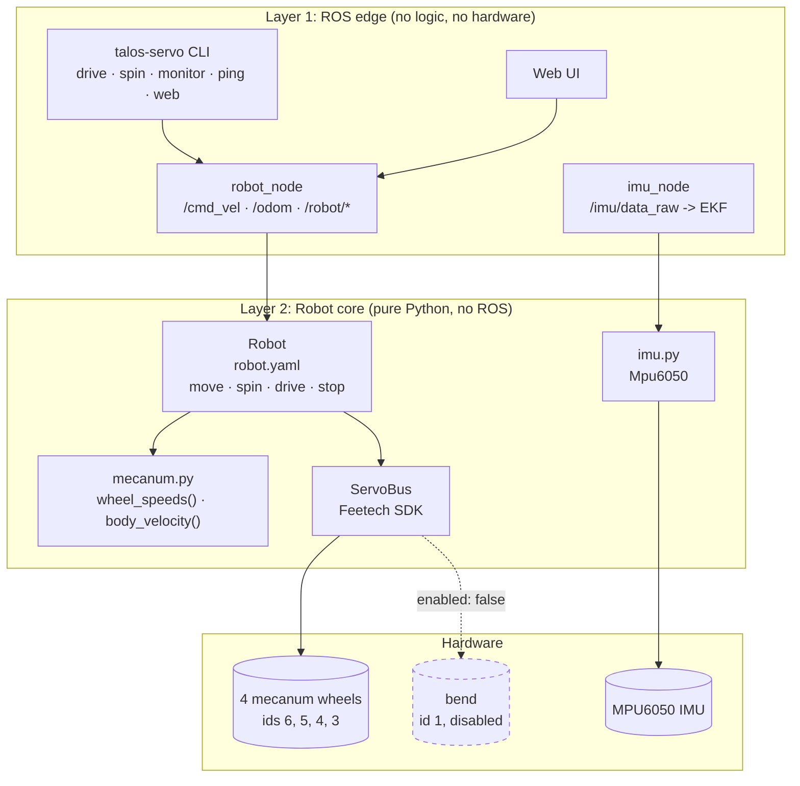
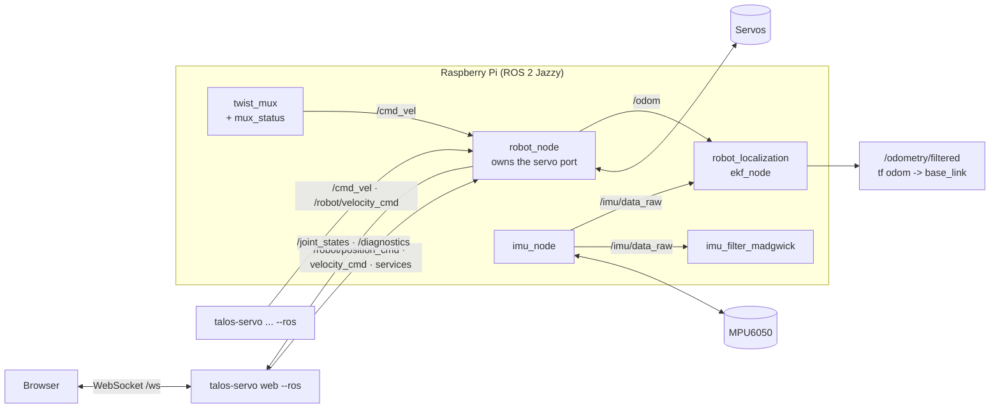
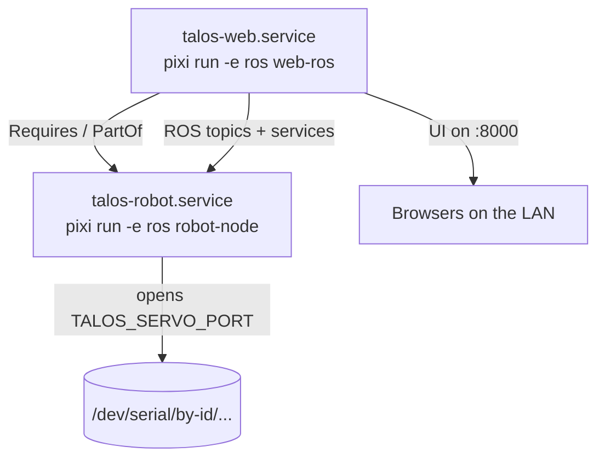

# talos_hack

Software for the Talos robot from the physical AI hackathon: a mecanum base
driven by Feetech STS/SMS serial bus servos on one bus, plus an MPU6050 IMU.

Contributing (humans and AI agents): read [AGENTS.md](AGENTS.md). Everything
goes through PRs.

## Architecture

**One rule: one `Robot` owns the servo bus, one node owns the `Robot`.**



| Layer | Job | Rule |
| --- | --- | --- |
| 1. ROS edge | Messages and keys to method calls | No logic, no hardware |
| 2. Robot core | All logic and hardware access | No ROS, tested with fakes |

Without ROS, the CLI and the web server build the `Robot` themselves on the
serial port. Then nothing else can use the servos.

| Path | What it is |
| --- | --- |
| `src/talos_servo/robot.py` | `Robot`: limits, direction, watchdog, stop |
| `src/talos_servo/config.py` | Reads `config/robot.yaml` |
| `src/talos_servo/mecanum.py` | Mecanum kinematics, pure functions |
| `src/talos_servo/bus.py` | `ServoBus`: safe wrapper around the SDK |
| `src/talos_servo/cli.py` | The `talos-servo` command |
| `src/talos_servo/teleop.py` | Keyboard driving for `talos-servo drive` |
| `src/talos_servo/ros/` | `robot_node`, `imu_node`, the ROS client |
| `src/talos_servo/web/` | FastAPI server for the web UI |
| `web/` | Next.js UI, built into `web/out` |
| `deploy/` | systemd units for the Pi |

### ROS graph



### On the Pi



### ros2_control (in progress, #62)

Control is moving to ros2_control. How it works with our Python code (the
topic based hardware plugin plus `hardware_bridge_node`) and the bench check
`pixi run -e ros ros2-control-check` are in
[docs/ros2_control.md](docs/ros2_control.md).

### Robot model (#64)

`description/talos.urdf.xacro` is the robot for ROS: the `bend` hinge, the
two legs and the four mecanum wheels, plus `imu_link` and `camera_link`. It
reads its sizes, limits and joint names from the `model` and `base` sections
of `config/robot.yaml`, so change them there.

The robot is an inverted V: the hinge on top with the platform, a leg down
to each wheel pair. Each leg is half of `base.wheelbase_m` (the flat
wheelbase) long. The hinge joint (`model.hinge_joint`, `bend`) is the
opening angle between the legs in radians: pi (180 deg) flat,
`bend_min_deg` at max fold.
The legs follow it through mimic joints, each tilting by half the fold, so
the platform stays level. The wheelbase is `2 * l * sin(bend / 2)`
(`talos_servo.model.wheelbase_m`).

The `<ros2_control>` block drives only the four wheels for now. The hinge
joins it in #85, together with the conversion from opening angle to servo
angle (`talos_servo.model.alpha_per_servo_rad`) and the flat offset from the
calibration in #84.

View it in RViz2 (needs a display; installs RViz only in the `viz`
environment, not on the Pi; works on Linux and Windows):

```
pixi install -e viz
pixi run -e viz view-model    # RViz2 plus a slider per joint
```

Drag the `bend` slider from 3.14 (flat) down to 1.57 (max fold): the legs
fold symmetrically and the platform stays level. Check the model with
`pixi run -e ros check-model` (`check_urdf`) or print it with
`pixi run -e ros model-urdf`.

## Quick start

Use [uv](https://docs.astral.sh/uv/) or [pixi](https://pixi.sh); both read
`pyproject.toml`. ROS 2 Jazzy comes only through pixi (`ros` environment).

```
uv sync                  # or: pixi install
pixi install -e ros      # ROS 2, for the robot node, IMU node and EKF
```

Find the servo adapter and set it once per shell (or pass `--port`):

```
uv run talos-servo ports
export TALOS_SERVO_PORT=/dev/serial/by-id/usb-1a86_USB_Single_...  # bash
$env:TALOS_SERVO_PORT = "COM5"                                     # PowerShell
```

## Commands

| Command | What it does |
| --- | --- |
| `talos-servo ping --ids 1-6` | Which servos answer, with their model number |
| `talos-servo spin --ids 1 --speed 100` | Spin for 1 s, then stop |
| `talos-servo monitor --ids 1` | Print position and speed until Ctrl+C |
| `talos-servo set-id --id 1 --new-id 3` | Change a servo id (EEPROM) |
| `talos-servo drive` | Drive with the keyboard: W/S, A/D, Q/E, X |
| `talos-servo web` | Browser UI on port 8000 |
| `talos-servo imu --calibrate` | Stream the MPU6050 until Ctrl+C |
| `pixi run -e ros robot-node` | The robot node, the only program on the port |
| `pixi run -e ros drive` | `talos-servo drive --ros` |
| `pixi run -e ros web-ros` | `talos-servo web --ros` |
| `pixi run -e ros imu-node` | IMU as ROS topics |
| `pixi run -e ros mode-node` | Robot mode, switches controllers per mode |
| `pixi run -e ros ekf` | Pose estimate from wheels and gyro |
| `pixi run -e ros twist-mux` | Web and keyboard share `/cmd_vel` |
| `pixi run -e ros mux-status` | Who drives, on `/robot/active_input` |

- `--ros` (on `spin`, `monitor`, `drive`, `web`) goes through the running robot
  node instead of the port, so these can run next to each other.
- `ping`, `spin`, `monitor` and `set-id` without `--ros` are bench tools: they
  take servo ids and work without a config.
- Every command stops what it started on exit, including Ctrl+C.
- New servos ship with id 1. Connect them one at a time and give each its own
  id with `set-id` before chaining them.

## Config: `config/robot.yaml`

Every joint is set here and nowhere else. Changes take effect on restart.

```yaml
max_speed: 1000          # steps/s cap for every joint, low on purpose
command_timeout_s: 0.5   # ROS speed commands stop if not repeated
joints:
  front_left_wheel:  { id: 6, control: speed,    inverted: true }
  front_right_wheel: { id: 5, control: speed,    inverted: false }
  rear_left_wheel:   { id: 4, control: speed,    inverted: true }
  rear_right_wheel:  { id: 3, control: speed,    inverted: false }
  bend:              { id: 1, control: position, inverted: false,
                       enabled: false, min_pos: 0, max_pos: 4095 }
base:
  wheels: [front_left_wheel, front_right_wheel, rear_left_wheel,
           rear_right_wheel]
  wheelbase_m: 0.31
  track_width_m: 0.128
  wheel_radius_m: 0.03     # steps per metre = 4096 / (2 * pi * r)
  max_linear_speed: 0.1    # m/s
  max_angular_speed: 0.5   # rad/s
```

| Key | Values | What it does |
| --- | --- | --- |
| `control` | `speed` / `position` | Fixed at startup; spin needs speed |
| `inverted` | `false` / `true` | Flips direction, so positive is forward |
| `enabled` | `true` / `false` | `false`: never touched, hidden everywhere |

- **Find the `inverted` values:** lift the wheels, run `talos-servo drive`,
  press W, and set `inverted: true` on any wheel that turns backwards.
- **Enable bend once it is installed:** set `enabled: true` and real
  `min_pos`/`max_pos`, then restart. Its topics appear under `/robot/bend/`.

## ROS topics

| Topic or service | Type | Direction |
| --- | --- | --- |
| `/cmd_vel` | `geometry_msgs/Twist` | in: drive the base |
| `/odom` | `nav_msgs/Odometry` | out: wheel odometry, no TF |
| `/joint_states` | `sensor_msgs/JointState` | out: rad, rad/s, load |
| `/diagnostics` | `DiagnosticArray` | out: one entry per joint |
| `/robot/position_cmd` | `sensor_msgs/JointState` | in: goal angles |
| `/robot/velocity_cmd` | `sensor_msgs/JointState` | in: speeds, expire |
| `/robot/<joint>/temperature` ... | `Temperature`, `Float32`, `Bool` | out |
| `/robot/stop_all` | `std_srvs/Trigger` | stop every speed joint |
| `/robot/<joint>/set_torque` | `std_srvs/SetBool` | torque on/off |
| `/robot/mode`, `/robot/mode_reason` | `std_msgs/String` | out: latched |
| `/robot/wall_nearby` | `std_srvs/Trigger` | free -> aligning |
| `/robot/release` | `std_srvs/Trigger` | any mode -> free |
| `/imu/data_raw`, `/imu/data` | `sensor_msgs/Imu` | out: IMU, filtered |
| `/odometry/filtered` | `nav_msgs/Odometry` | out: EKF pose |
| `/web/cmd_vel` | `geometry_msgs/Twist` | in: twist_mux, web |
| `/keyboard/cmd_vel` | `geometry_msgs/Twist` | in: twist_mux, keyboard |
| `/robot/set_stop` | `std_srvs/SetBool` | true: STOP, false: release |
| `/robot/stop_lock` | `std_msgs/Bool` | out: STOP state, 10 Hz |
| `/robot/active_input` | `std_msgs/String` | out: who drives |

`/cmd_vel` and `velocity_cmd` stop the wheels unless repeated within
`command_timeout_s`. Every client on the robot must use the same
`ROS_DOMAIN_ID`.

### Web and keyboard through twist_mux

`twist_mux` merges `/web/cmd_vel` and `/keyboard/cmd_vel` into `/cmd_vel`
(`config/twist_mux.yaml`). The keyboard has the higher priority, so it wins
while a key is held; an input that is quiet for 0.5 s stops counting and the
other one takes over. STOP blocks both: the mode node owns it, starts with
STOP on and repeats it on `/robot/stop_lock` every 0.1 s. Release it with
`/robot/set_stop` `false`. The lock times out after 0.5 s, so the mux stays
locked while the mode node is not running, and a restarted twist_mux is
locked again by the next beat. `mux-status` publishes `keyboard`, `web`,
`none` or `locked` on `/robot/active_input` for the UIs.

The web server (`web-ros`) sends the browser's `drive` messages on
`/web/cmd_vel`. The browser re-sends them every 100 ms while a button is held
and sends one stop on release, so a closed tab drops out of the mux within
0.5 s.

**`/robot/stop_lock` is not a working STOP yet.** The web UI is on its mux
input, but `drive --ros` still publishes straight to `/cmd_vel` until #73
moves it, so the lock does not stop the keyboard. Running `twist-mux` next
to it also adds a second publisher on `/cmd_vel`. The web STOP button calls
the robot node's `stop_all`, which a browser still holding a drive button
overrides on its next message; STOP from the UIs through the lock is #108.
Use `/robot/stop_all` and let go of every button to stop the robot.

```
pixi run -e ros mode-node
pixi run -e ros twist-mux
pixi run -e ros mux-status
ros2 topic pub -r 10 /web/cmd_vel geometry_msgs/msg/Twist   "{linear: {x: 0.05}}"
ros2 service call /robot/set_stop std_srvs/srv/SetBool "{data: false}"
ros2 service call /robot/set_stop std_srvs/srv/SetBool "{data: true}"
ros2 topic echo /robot/active_input
```

### ROS commands

Run these in `pixi shell -e ros` (or prefix them with `pixi run -e ros`). Keep
the wheels lifted the first time.

Drive the base. `/cmd_vel` stops unless repeated, so publish at a rate; Ctrl+C
stops the wheels within `command_timeout_s`:

```
ros2 topic pub -r 10 /cmd_vel geometry_msgs/msg/Twist \
  "{linear: {x: 0.05}}"                  # forward
ros2 topic pub -r 10 /cmd_vel geometry_msgs/msg/Twist \
  "{linear: {y: 0.05}}"                  # strafe left
ros2 topic pub -r 10 /cmd_vel geometry_msgs/msg/Twist \
  "{angular: {z: 0.3}}"                  # turn left
```

One joint. Velocities are rad/s (1 rad/s is about 650 steps/s), positions are
rad with 0 at mid travel:

```
ros2 topic pub -r 10 /robot/velocity_cmd sensor_msgs/msg/JointState \
  "{name: [front_left_wheel], velocity: [1.0]}"
ros2 topic pub --once /robot/position_cmd sensor_msgs/msg/JointState \
  "{name: [bend], position: [0.5], velocity: [1.0]}"
```

Services and state:

```
ros2 service call /robot/stop_all std_srvs/srv/Trigger
ros2 service call /robot/front_left_wheel/set_torque std_srvs/srv/SetBool \
  "{data: false}"
ros2 topic echo /joint_states
ros2 topic echo /odom
ros2 topic echo /diagnostics             # one entry per joint
ros2 topic echo /robot/front_left_wheel/temperature
ros2 topic hz /odom
```

Robot node parameters go after `--ros-args`, e.g.
`pixi run -e ros talos-robot-ros --ros-args -p status_hz:=5.0`.

### Robot modes

The mode node (`pixi run -e ros mode-node`) owns the robot mode and switches
ros2_control controllers when it changes. The state machine itself is plain
Python in `talos_servo.modes`.

| From | Event | To |
| --- | --- | --- |
| `free` | wall nearby (`/robot/wall_nearby`) | `aligning` |
| `aligning` | aligned with the walls | `clamping` |
| `clamping` | wheels press on both walls | `climbing` |
| `climbing` | not moving up | `clamping` |
| any | release (`/robot/release`) | `free` |

- Controllers per mode come from `modes.controllers` in `config/robot.yaml`.
  The node diffs the new mode's set against the controllers
  controller_manager reports as active, and a switch that controller_manager
  rejects keeps the old mode. Every second it also puts the active
  controllers back to the current mode's set (late start, restart, a switch
  applied after a timeout).
- While controller_manager is not running the switch is skipped with a
  warning, so the mode node works before the controllers exist. Set
  `-p require_controller_manager:=true` to make the mode change fail
  instead.
- In `clamping` and `climbing` STOP stops the wheels but the hinge keeps
  holding the walls.

```
ros2 topic echo /robot/mode
ros2 service call /robot/wall_nearby std_srvs/srv/Trigger
ros2 service call /robot/release std_srvs/srv/Trigger
```

## Web UI

The per-motor page lives at `/debug` for bench tests; `/` is kept for the
joystick. On `/debug` each joint gets a card: a position slider for position
joints, a speed slider for speed joints, plus torque, live state and who sent
the last command. Several browsers can connect at once.

```
cd web && npm install && npm run build    # once, Node 20+
uv run talos-servo web                    # or: pixi run -e ros web-ros
```

Open `http://<pi>.local:8000/debug`. **STOP ALL** (or Space) stops every speed
joint, including wheels the CLI or a ROS node is driving. `/` has a STOP ALL
button too and keeps its own connection. When the last browser disconnects,
the server stops only what the web commanded: the joints it spins and its
twist_mux input. Over ROS, keyboard driving carries on. For UI work with hot
reload,
run `npm run dev` in `web/` with `NEXT_PUBLIC_BRIDGE_URL=ws://<pi>:8000/ws`.

## IMU and pose estimate

Wire the MPU6050 to the Pi's I2C pins (VCC to 3.3 V on pin 1, GND pin 6, SDA
pin 3, SCL pin 5, AD0 to GND for 0x68), enable I2C in `raspi-config`, and check
`i2cdetect -y 1` shows `68`.

```
pixi run -e ros imu-node     # keep the robot still while the gyro zeroes
pixi run -e ros imu-filter   # orientation, config/imu_filter.yaml
pixi run -e ros imu-tf       # where the IMU sits (zeros until mounted)
pixi run -e ros ekf          # fuses /odom and gyro, config/ekf.yaml
```

The EKF uses wheel velocities and the gyro yaw rate only: mecanum wheels slip,
and the IMU has no magnetometer.

## Deploy on the Pi

Edit the user, paths and serial port in both units, then:

```
sudo cp deploy/talos-robot.service deploy/talos-web.service \
  /etc/systemd/system/
sudo systemctl daemon-reload
sudo systemctl enable --now talos-robot talos-web
journalctl -u talos-robot -u talos-web -f
```

Moving from an older setup: `sudo systemctl disable --now talos-servo-bridge`
first, since it holds the same port.

## Development

```
pixi run check           # lint + format check + tests, like CI
pixi run -e ros test     # also runs the ROS tests (Linux)
cd web && npm run lint && npm run build
```

Tests use a fake SDK and never open a serial port. ROS tests run on a private
ROS domain, so they cannot reach a robot on the same network. Code is
formatted by ruff at 80 characters per line.
