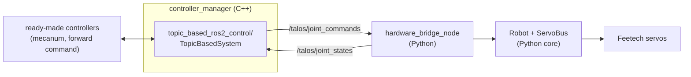

# How we use ros2_control from Python

Decision for #88, part of the move to ros2_control (#62).

## Rule

Python by default. ros2_control only loads hardware interfaces and
controllers as C++ plugins, so we use ready-made ones and write no C++
ourselves. C++ is allowed only for a plugin that cannot be avoided; it then
needs its own colcon build and a C++ job in CI.

## How it fits together



- **Hardware:** `topic_based_ros2_control/TopicBasedSystem` (RoboStack
  `ros-jazzy-topic-based-ros2-control`) is the hardware plugin. Each control
  cycle it publishes the commands as a `sensor_msgs/JointState` and reads the
  latest states from another one.
- **Our side:** `talos_servo.ros.hardware_bridge_node` answers those topics
  with the existing `Robot` on the servo bus. The command watchdog, motor
  inversion, limits and SDK error checks stay in the Python core, which is
  tested with the fake SDK.
- **Controllers:** ready-made ones from `ros2_controllers`:
  `mecanum_drive_controller` for the base (#65), and
  `JointGroupVelocityController` / `JointGroupPositionController` for the
  rest.
- **Custom behaviour** (expansion #76, hold force #79, climb #80): Python
  nodes that send commands to those controllers, not C++ controllers.
- **Robot model:** `description/talos.urdf.xacro` (#64) holds the joints and
  the `<ros2_control>` block for the whole robot. `bend` is the hinge
  opening in radians (pi flat). See "Robot model" in the README.

## Port ownership

The bridge node is the only program on the servo port, like the robot node
today. Never run both: the port lock in `bus.py` refuses the second one. The
controller_manager itself never opens the port.

## What the plugin can and cannot carry

Checked in the plugin source (0.3.0):

| Topic field | Command | State |
|---|---|---|
| `position` | goal angle, rad (position joints) | rad, always sent |
| `velocity` | speed, rad/s (speed joints) | rad/s |
| `effort` | not used | present current, A |

- Only `position`, `velocity` and `effort` interfaces exist. Any other
  interface name in the URDF (`current`, `load`) makes the plugin fail to
  load. So current goes in `effort`, and load, temperature, voltage and
  current stay on the bridge's readout topics
  (`/hardware_bridge/<joint>/load` and the rest). Controllers that need
  load read those topics, not ros2_control.
- Commands are packed per interface in joint order, not aligned with
  `name`: with `bend` (position) and four wheels (velocity) a message has 5
  names, 1 position and 4 velocities. `talos_servo.ros.topic_bridge` unpacks
  them using `control` from `config/robot.yaml`, which must match the
  command interface in the URDF.
- Set `trigger_joint_command_threshold` to `-1`. Otherwise the plugin skips
  a command when the summed position error is tiny, and it only looks at
  position, so velocity commands to a wheel resting near 0 rad are dropped.
  The stream also feeds the bridge watchdog.
- The plugin has no watchdog of its own. The bridge spins wheels with the
  `Robot` command timeout (`command_timeout_s`), so if the controller_manager
  dies the wheels stop within that time.
- That watchdog does not cover a controller that keeps its last command.
  The forward command controllers hold the last value forever, and the
  plugin streams it, so one 0.5 rad/s message spins the wheel until 0 is
  sent. Teleop must go through something with a timeout:
  `mecanum_drive_controller` has `reference_timeout` (#65), and twist_mux
  has its own (#93).
- Wheel positions keep counting past a full turn (the bridge unwraps the
  0..4095 servo reading), so odometry does not jump.

## The hinge (#85, #63)

- **Interfaces:** `bend` takes a position command and reports position,
  velocity and effort, all in the opening angle alpha: rad and rad/s, pi
  flat. `talos_servo.hinge.Hinge` converts it to servo steps with
  `talos_servo.model.alpha_per_servo_rad` (1:1 today) and clamps goals to
  `model.bend_min_deg`..`bend_max_deg`. There is no `<transmission>`: the
  plugin ignores them.
- **Flat position:** `model.bend_flat_steps` in `config/robot.yaml`, written
  by the calibration (#84). Without it the hinge counts as flat wherever it
  is when the bridge starts, so start it flat. If the servo is offline at
  start, `bend` reads pi and its goals are dropped (logged) until it
  answers.
- **No wrap:** position mode covers one servo turn and never crosses
  4095 -> 0, so there are no turns to count. The range from flat down to max
  fold must fit inside 0..4095; the config check and the bridge refuse a
  flat position where it does not. Fix that by turning the servo horn, not
  with an EEPROM offset.
- **Startup:** the plugin takes the position state `initial_value` (pi) as
  the first command and sends it until a controller writes a goal, even
  when no controller claims `bend`. The bridge ignores goals equal to a
  position joint's initial value (pi for the hinge, 0.0 for others) until
  the first different goal, then follows every goal. So starting the stack
  never moves the hinge. A NaN position means no goal and never blocks the
  wheel velocities in the same message.
- **Current and load:** `/dynamic_joint_states` shows position, velocity
  and effort only. Effort is the present current (A). Load stays on
  `/hardware_bridge/<joint>/load`.

## Bench: the whole robot

`config/ros2_control.yaml` and `launch/ros2_control.launch.py` run every
wheel through a `JointGroupVelocityController` and the hinge through a
`JointGroupPositionController`, on `description/talos.urdf.xacro` built from
the same robot config as the bridge. Stop the robot node first.

```
pixi run -e ros ros2-control port:=/dev/ttyACM0
ros2 control list_hardware_interfaces
ros2 topic pub --once /bend_position_controller/commands \
  std_msgs/msg/Float64MultiArray "{data: [2.8]}"
ros2 topic pub -r 10 /wheel_velocity_controller/commands \
  std_msgs/msg/Float64MultiArray "{data: [0.5, 0.5, 0.5, 0.5]}"
ros2 topic echo /dynamic_joint_states
```

The wheel controller keeps its last command: publish zeros to stop.

## Open points

- **State rate:** the bridge publishes states at `telemetry_hz` (20 Hz by
  default), and `Robot.tick` reads one servo per tick round robin, so with 5
  joints each one is refreshed at about 10 Hz. controller_manager runs at
  50 Hz, so controllers see repeated samples. Fine for the bench; the
  odometry in #65 needs fresher wheel states (for example a sync read of the
  wheels every tick).

## Fallback

If the plugin turns out too limited (for example a controller must read
load through ros2_control), write a small C++ hardware interface on the
Feetech C++ SDK. That is the only C++ in the repo and it needs a C++ build
and test job in CI.

## Bench check: one wheel (#88)

`description/ros2_control_check.urdf`, `config/ros2_control_check.yaml` and
`launch/ros2_control_check.launch.py` run one wheel (`front_left_wheel`)
through a `JointGroupVelocityController`. Stop the robot node first.

```
pixi run -e ros ros2-control-check port:=/dev/ttyACM0
ros2 control list_hardware_interfaces
ros2 control list_controllers
ros2 topic pub -r 10 /wheel_velocity_controller/commands \
  std_msgs/msg/Float64MultiArray "{data: [0.5]}"
ros2 topic echo /dynamic_joint_states
```
