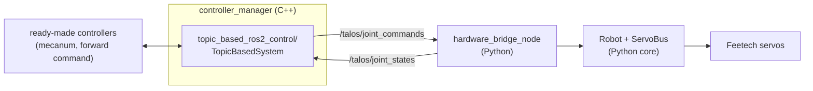

# How we use ros2_control from Python

Decision for #88, part of the move to ros2_control (#62).

## Rule

Python by default. ros2_control only loads hardware interfaces and
controllers as C++ plugins, so we use ready-made ones and write no C++
ourselves. C++ is allowed only for a plugin that cannot be avoided; it then
needs its own colcon build and a C++ job in CI.

## How it fits together



- **Hardware:** `topic_based_ros2_control/TopicBasedSystem` (RoboStack
  `ros-jazzy-topic-based-ros2-control`) is the hardware plugin. Each control
  cycle it publishes the commands as a `sensor_msgs/JointState` and reads the
  latest states from another one.
- **Our side:** `talos_servo.ros.hardware_bridge_node` answers those topics
  with the existing `Robot` on the servo bus. The command watchdog, motor
  inversion, limits and SDK error checks stay in the Python core, which is
  tested with the fake SDK.
- **Controllers:** ready-made ones from `ros2_controllers`:
  `mecanum_drive_controller` for the base (#65), and
  `JointGroupVelocityController` / `JointGroupPositionController` for the
  rest.
- **Custom behaviour** (expansion #76, hold force #79, climb #80): Python
  nodes that send commands to those controllers, not C++ controllers.
- **Robot model:** `description/talos.urdf.xacro` (#64) holds the joints and
  the `<ros2_control>` block for the whole robot. `bend` is the hinge
  opening in radians (pi flat). See "Robot model" in the README.

## Port ownership

The bridge node is the only program on the servo port, like the robot node
today. Never run both: the port lock in `bus.py` refuses the second one. The
controller_manager itself never opens the port.

## What the plugin can and cannot carry

Checked in the plugin source (0.3.0):

| Topic field | Command | State |
|---|---|---|
| `position` | goal angle, rad (position joints) | rad, always sent |
| `velocity` | speed, rad/s (speed joints) | rad/s |
| `effort` | not used | present current, A |

- Only `position`, `velocity` and `effort` interfaces exist. Any other
  interface name in the URDF (`current`, `load`) makes the plugin fail to
  load. So current goes in `effort`, and load, temperature, voltage and
  current stay on the bridge's readout topics
  (`/hardware_bridge/<joint>/load` and the rest). Controllers that need
  load read those topics, not ros2_control.
- Commands are packed per interface in joint order, not aligned with
  `name`: with `bend` (position) and four wheels (velocity) a message has 5
  names, 1 position and 4 velocities. `talos_servo.ros.topic_bridge` unpacks
  them using `control` from `config/robot.yaml`, which must match the
  command interface in the URDF.
- Set `trigger_joint_command_threshold` to `-1`. Otherwise the plugin skips
  a command when the summed position error is tiny, and it only looks at
  position, so velocity commands to a wheel resting near 0 rad are dropped.
  The stream also feeds the bridge watchdog.
- The plugin has no watchdog of its own. The bridge spins wheels with the
  `Robot` command timeout (`command_timeout_s`), so if the controller_manager
  dies the wheels stop within that time.
- That watchdog does not cover a controller that keeps its last command.
  The forward command controllers hold the last value forever, and the
  plugin streams it, so one 0.5 rad/s message spins the wheel until 0 is
  sent. Teleop must go through something with a timeout:
  `mecanum_drive_controller` has `reference_timeout` (#65), and twist_mux
  has its own (#93).
- Wheel positions keep counting past a full turn (the bridge unwraps the
  0..4095 servo reading), so odometry does not jump.

## The hinge (#85, #63)

- **Interfaces:** `bend` takes a position command and reports position,
  velocity and effort, all in the opening angle alpha: rad and rad/s, pi
  flat. `talos_servo.hinge.Hinge` converts it to servo steps with
  `talos_servo.model.alpha_per_servo_rad` (1:1 today) and clamps goals to
  `model.bend_min_deg`..`bend_max_deg`. There is no `<transmission>`: the
  plugin ignores them.
- **Flat position:** `model.bend_flat_steps` in `config/robot.yaml`, the
  raw servo position when the robot lies flat (4000, a margin before the
  wrap at 4095). It is fixed by aligning the servo horn to the leg, so the
  servo's absolute position is the hinge angle and nothing is measured at
  startup. It is required while
  `bend` is enabled, and `joints.bend` `min_pos`/`max_pos` are narrowed on
  load to the `bend_min_deg`..`bend_max_deg` range, so every move is
  clamped to it (robot node, `/debug` and the bridge alike).
- **Unknown angle:** while the servo is offline, or reads more than 64
  steps outside the hinge range (a wrap past flat), `bend` reports NaN
  position and velocity, logs an error and drops its goals: from a wrapped
  reading the servo would take the long way round.
- **No wrap:** position mode covers one servo turn and never crosses
  4095 -> 0, so there are no turns to count. The range from flat down to max
  fold must fit inside 0..4095; the config check and the bridge refuse a
  flat position where it does not. Fix that by turning the servo horn, not
  with an EEPROM offset.
- **Startup:** the plugin repeats the last goal of a position joint: the
  position state `initial_value` (pi) until a controller writes one, even
  when no controller claims `bend`, or the controller's last goal when only
  the bridge restarts. The bridge ignores the first goal each position
  joint gets and every repeat of it, then follows every goal from the first
  different one. It starts over when the commands go quiet for
  `command_timeout_s` (controller_manager restarted). So starting or
  restarting either side never moves the hinge; send a new goal to move it.
  A disabled hinge stays out of `<ros2_control>` and its controller is not
  spawned, so the wheels still run without it. A NaN position means no
  goal and never blocks the wheel velocities in the same message.
- **Current and load:** `/dynamic_joint_states` shows position, velocity
  and effort only. Effort is the present current (A). Load stays on
  `/hardware_bridge/<joint>/load`.

## The base (#65)

`mecanum_drive_controller` from ros2_controllers drives the four wheels.
Its config is in `config/ros2_control.yaml`.

- **Input:** `geometry_msgs/TwistStamped` on
  `/mecanum_drive_controller/reference`, which twist_mux publishes
  (`use_stamped: true`). The keyboard, the web server and the robot node use
  `TwistStamped` too.
- **Timeout:** `reference_timeout` 0.5 s (= `command_timeout_s`). After that
  without a reference the controller sends zero. It also drops references
  stamped more than 0.5 s ago, so a laptop that sends keyboard commands needs
  its clock synced with the Pi. A zero stamp is taken as "now", but the
  controller warns on every such message.
- **Kinematics:** the same as the old `talos_servo.mecanum.wheel_speeds`:
  `wheels_radius` = `base.wheel_radius_m`, and
  `sum_of_robot_center_projection_on_X_Y_axis` = (wheelbase + track) / 2,
  with the hinge flat. Every wheel is "positive rolls forward"; the bridge
  applies `inverted`, so there is no sign handling in the controller config.
- **Speed limits:** `linear.x/y` and `angular.z` `max_velocity` /
  `min_velocity` are `base.max_linear_speed` and `base.max_angular_speed`.
  These are the only limits on this path. The bridge does not clip base
  wheels to `max_speed` (`Robot.spin(capped=False)`), and the old
  proportional scaling of the four wheels is gone. Full stick therefore
  drives faster than the robot node did, where `max_speed` 1000 steps/s
  capped the wheels at about 0.046 m/s.
- **Odometry:** `/mecanum_drive_controller/odometry` is remapped to `/odom`
  for the EKF. `enable_odom_tf` is false, so the EKF alone publishes
  odom -> base_link.
- **Modes:** the mode node activates it in `free` and `aligning`.
  `clamping` hands the wheels to `wheel_velocity_controller` for the
  expansion node (#76). `climbing` lists no controller until #92, so the
  base stops there.

`tests/test_ros2_control_config.py` checks the values against
`config/robot.yaml`, and the wheel signs against the old kinematics.

## Safe state (#94)

Whenever control stops, the bridge leaves the servos so the robot can hang
between two walls: wheels at speed 0 with torque on (braked) and the hinge on
its last goal with torque on. Torque is never turned off on the way.
`Robot.hold_safe(reason)` is the one function for it, so faults found
elsewhere (#87) reuse it.

- **Deactivate, or controller_manager gone:** the plugin does not tell the
  bridge, the commands just stop. The wheels stop after
  `command_timeout_s`, the hinge keeps its goal.
- **Read or write error:** a failed wheel write, a failed command, or a
  joint that was online and stops answering brakes the wheels at once and
  latches. Commands that would move (a wheel speed, a hinge goal) are refused
  and logged; stops always work. The latch frees itself once the lost joints
  answer again and wheel writes work for `FAULT_CLEAR_S` (1 s). A servo that
  is missing from the start does not latch, so bench tests with some servos
  unplugged still work. A failed wheel sync read (odometry) does not latch
  either: one lost request packet fails it, and braking for a second on that
  would be worse. A wheel that really stops answering is caught by the
  round-robin read within one cycle (one joint per tick, about 0.1 s).
- **Shutdown:** `Robot.close()` runs in `finally`, also on Ctrl+C.

## Bench: the whole robot

`config/ros2_control.yaml` and `launch/ros2_control.launch.py` run the base
through `mecanum_drive_controller` and the hinge through a
`JointGroupPositionController`, on `description/talos.urdf.xacro` built from
the same robot config as the bridge, without the teleop nodes. Stop the
robot node first. `pixi run -e ros robot` starts the same plus twist_mux,
the mode node and the web server (`pixi run -e ros twist-mux-control` adds
just the mux).

```
pixi run -e ros ros2-control port:=/dev/ttyACM0
ros2 control list_hardware_interfaces
ros2 control list_controllers
ros2 topic pub -r 10 /mecanum_drive_controller/reference \
  geometry_msgs/msg/TwistStamped "{twist: {linear: {x: 0.05}}}"
ros2 topic pub --once /bend_position_controller/commands \
  std_msgs/msg/Float64MultiArray "{data: [2.8]}"
ros2 topic echo /odom
ros2 topic echo /dynamic_joint_states
```

`wheel_velocity_controller` (one rad/s value per wheel) is spawned
inactive, since it claims the same wheels. The mode node switches it in for
the expansion node (below). It keeps its last command: publish zeros to
stop.

## Opening and closing the hinge (#76)

`expansion_node.py` (`pixi run -e ros expansion-node`, started by
`pixi run -e ros robot`) moves the hinge and turns the wheels with it, so
they roll instead of dragging. The math is in `talos_servo.expansion` and
[hinge_kinematics.md](hinge_kinematics.md).

- **Input:** `std_msgs/Float64` on `/expansion/rate`, the opening speed in
  rad/s: positive expands, negative collapses, 0 stops. Repeat it at least
  every `expansion.command_timeout_s` (0.5 s) or the motion stops. It is
  capped at `expansion.max_rate_rad_s` (0.15).
- **Output:** small hinge goal steps on `/bend_position_controller/commands`
  and the four wheel speeds on `/wheel_velocity_controller/commands`, at
  `expansion.rate_hz`. The bridge moves the hinge servo at one fixed speed
  (`DEFAULT_MOVE_SPEED`, about 0.31 rad/s), so the goal steps set the hinge
  speed, and `max_rate_rad_s` must stay below it. If the hinge falls more
  than `max_lead_rad` behind its goal (a wall, a stall), the goal and the
  wheels wait for it.
- **Limits:** no expanding at `model.bend_max_deg`, no collapsing at
  `model.bend_min_deg`, and nothing while the hinge angle is unknown.
- **Modes:** only `free` and `clamping`, never while STOP is on or its beats
  are missing. Clamping runs `wheel_velocity_controller` anyway. In `free`
  the node first asks the mode node (`/robot/hinge_motion`) to swap it in
  for `mecanum_drive_controller` (`modes.hinge_motion`), and gives the
  wheels back when it stops. Driving the base does nothing meanwhile.
- **Stopping:** on rate 0, timeout, STOP, a mode change, a limit and exit
  the wheels get zeros, and the hinge keeps its last goal, so a clamped
  robot keeps holding.

```
ros2 service call /robot/set_stop std_srvs/srv/SetBool "{data: false}"
ros2 topic pub -r 10 /expansion/rate std_msgs/msg/Float64 "{data: 0.1}"
```

## Open points

- **State rate:** every `Robot.tick` (`control_hz`, 50 Hz, the same as
  controller_manager) reads all wheel positions and speeds in one sync-read
  packet, and the bridge publishes states right after it, so the mecanum
  odometry sees fresh wheel states each cycle. Load, voltage, temperature,
  current and the hinge still come from the one-servo-per-tick round robin
  read, about 10 Hz per joint with 5 joints.

## Fallback

If the plugin turns out too limited (for example a controller must read
load through ros2_control), write a small C++ hardware interface on the
Feetech C++ SDK. That is the only C++ in the repo and it needs a C++ build
and test job in CI.

## Bench check: one wheel (#88)

`description/ros2_control_check.urdf`, `config/ros2_control_check.yaml` and
`launch/ros2_control_check.launch.py` run one wheel (`front_left_wheel`)
through a `JointGroupVelocityController`. Stop the robot node first.

```
pixi run -e ros ros2-control-check port:=/dev/ttyACM0
ros2 control list_hardware_interfaces
ros2 control list_controllers
ros2 topic pub -r 10 /wheel_velocity_controller/commands \
  std_msgs/msg/Float64MultiArray "{data: [0.5]}"
ros2 topic echo /dynamic_joint_states
```
